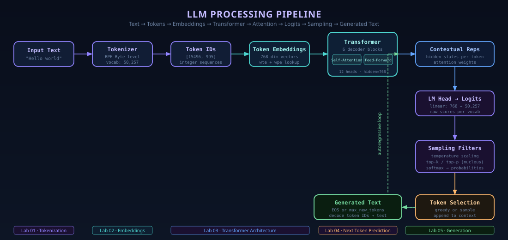
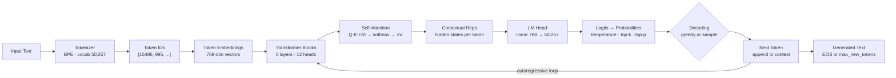
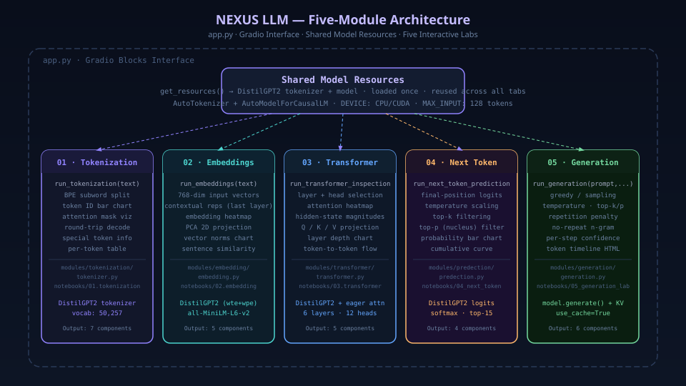
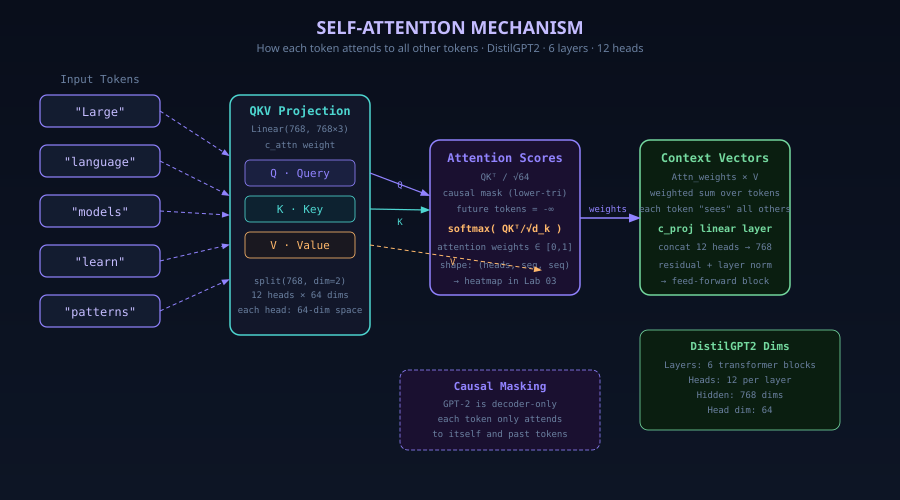
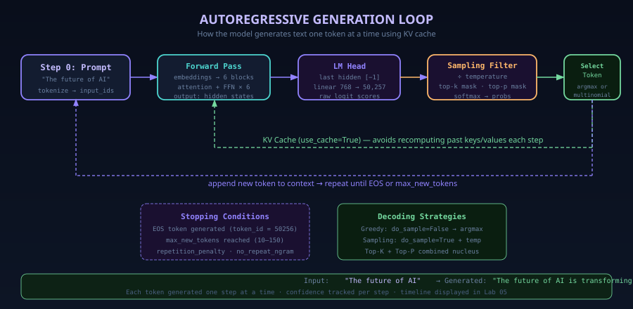
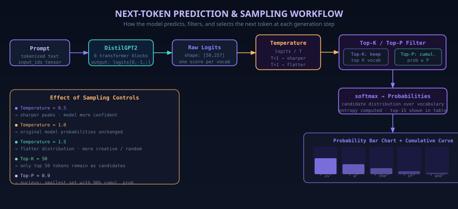

<div align="center">



<br/>


**An interactive educational workbench to explore how Large Language Models tokenize, represent, attend, predict, and generate language — step by step.**

[📋 Overview](#-overview) · [🧠 Five Labs](#-five-labs) · [🔄 Pipeline](#-llm-pipeline) · [⚙️ Setup](#️-installation--setup) · [📁 Structure](#-project-structure) · [📚 Notebooks](#-jupyter-notebooks) · [🛠 Stack](#️-technology-stack)

</div>

---

## 📋 Overview

**NEXUS LLM** is a locally-running AI engineering workbench built around `distilbert/distilgpt2`. Instead of treating language models as black-box chatbots, NEXUS opens every stage of the pipeline for hands-on inspection.

> **The core idea:** Every lab takes the same prompt and illuminates one specific stage — from raw text bytes all the way to generated output tokens.

### What problem does it solve?

Understanding LLMs requires knowledge of interconnected concepts that are rarely taught together:

| Concept | Complexity without a tool | NEXUS Lab |
|---|---|---|
| Subword tokenization | Abstract theory | **Lab 01** — live token chips with IDs |
| Token embeddings vs contextual representations | Often confused | **Lab 02** — side-by-side heatmaps |
| Multi-head self-attention | Hard to visualize | **Lab 03** — interactive head selector |
| Probability distributions & sampling | Requires code | **Lab 04** — sliders + bar charts |
| Autoregressive generation internals | Opaque in APIs | **Lab 05** — per-token confidence trace |

### Who can use this?

- 🎓 AI/ML students learning NLP fundamentals
- 🔬 Researchers who want to inspect pretrained model internals
- 👨‍💻 Engineers building LLM applications who want a deeper mental model
- 📖 Educators teaching Transformer architectures

### What makes it different from a chatbot?

A chatbot hides the internals. NEXUS exposes them:
- Every tokenization decision is visible
- Embedding vectors can be inspected numerically
- Any attention head in any layer can be selected and visualized
- Token selection probability is shown at every generation step

---

## 📸 Application Preview

> **⚠️ Screenshots required** — see the [screenshot guide](#-screenshots-to-capture) below for exactly which images to capture and where to save them.

### Dashboard

*Shared Workspace Prompt · Model Status · Five Lab Tabs*

### Lab 01 — Tokenization Studio

*Token chips · Token ID bar chart · Attention mask · Per-token table*

### Lab 02 — Embedding Explorer

*Input vs contextual embedding heatmaps · PCA projection · Vector norms · Sentence similarity*

### Lab 03 — Transformer Architecture Lab

*Attention head heatmap · Hidden-state magnitude · Q/K/V projection magnitudes*

### Lab 04 — Next Token Prediction Lab

*Probability bars · Cumulative probability curve · Distribution diagnostics*

### Lab 05 — Generation Lab

*Generated text · Token timeline · Per-step confidence chart · Generation trace table*

---

## 🧠 Five Labs

### Lab 01 · Tokenization Studio

**Function:** [`run_tokenization(text)`](app.py#L191)

Converts raw text into the integer sequences a Transformer actually receives.

**What it does:**
- Runs the GPT-2 byte-level BPE tokenizer on your input
- Displays each token as a visual chip with: `position`, `readable token`, `raw token`, `token ID`
- Plots token IDs as a bar chart by sequence position
- Visualizes the attention mask (1 = real token, 0 = padding)
- Round-trip decodes the token IDs back to text
- Reports vocabulary size, token count, and special-token configuration

**Key concept:** One "word" can become multiple subword tokens. The tokenizer uses a vocabulary of 50,257 items built by byte-level BPE.

**Outputs:** Token chip HTML · token table · token ID chart · mask visualization · decoded text · tokenizer info · special tokens

---

### Lab 02 · Embedding Explorer

**Functions:** [`run_embeddings(text)`](app.py#L337) · [`compare_sentence_similarity(a, b)`](app.py#L572)

Explores how token IDs become numerical vectors and how those vectors change through the model.

**What it does:**
- Extracts 768-dimensional **input token embeddings** (vocabulary lookup table `wte` + position `wpe`)
- Extracts **contextual representations** from the final Transformer layer's hidden states
- Renders a side-by-side heatmap (first 32 dimensions) comparing input vs contextual vectors
- Projects contextual vectors into 2D using PCA and plots the token space
- Charts L2 vector norms per token for both input and contextual representations
- Uses a **separate** `all-MiniLM-L6-v2` sentence-embedding model to compute cosine similarity between two sentences

**Key concept:** Input embeddings are static lookup table entries. Contextual representations are shaped by every other token through self-attention — the same word gets a different vector depending on its context.

**Outputs:** Vector table · embedding heatmaps · PCA chart · norm chart · info text

---

### Lab 03 · Transformer Architecture Lab

**Function:** [`run_transformer_inspection(text, layer_index, head_index)`](app.py#L655)

Opens the internals of each Transformer block — selectable by layer (0–5) and attention head (0–11).

**What it does:**
- Extracts all attention weight tensors (`output_attentions=True`)
- Renders the selected head as a **token-to-token attention heatmap** (query vs key tokens, magma colormap)
- Plots **hidden-state L2 norm** at each depth from input through all 6 blocks
- Extracts **Q, K, V projection magnitudes** per token by applying `ln_1 → c_attn → split`
- Reports architecture dimensions: layers, heads, hidden size, attention tensor shapes

**Key concept:** Rows in the attention heatmap are query tokens ("what is attending"), columns are key tokens ("what is being attended to"). Each head learns different patterns — some attend locally, others globally.

**Outputs:** Attention heatmap · layer depth chart · Q/K/V magnitude chart · architecture trace

---

### Lab 04 · Next Token Prediction Lab

**Function:** [`run_next_token_prediction(text, temperature, top_k, top_p)`](app.py#L1011)

Illuminates exactly how the model computes and filters the probability distribution for the very next token.

**What it does:**
- Runs a forward pass and extracts the final-position logits (`logits[0, -1, :]`)
- Applies **temperature scaling** (divides logits by T before softmax)
- Applies **Top-K filtering** — zeroes out all but the top-K logit entries
- Applies **Top-P (nucleus) filtering** — keeps the smallest high-probability token set whose cumulative probability reaches the threshold
- Runs softmax to compute final probabilities
- Plots top-15 candidates as a horizontal probability bar chart
- Plots the cumulative probability curve with the Top-P threshold line
- Reports distribution entropy in bits

**Sliders:** Temperature (0.1–2.0) · Top-K (0–100) · Top-P (0.1–1.0)

**Outputs:** Ranked token table · probability chart · cumulative curve · distribution info

---

### Lab 05 · Generation Lab

**Function:** [`run_generation(prompt, max_new_tokens, do_sample, temperature, top_k, top_p, repetition_penalty, no_repeat_ngram_size)`](app.py#L1187)

Runs full autoregressive generation and shows the internal process at every step.

**What it does:**
- Calls `model.generate()` with `output_scores=True` and `return_dict_in_generate=True`
- Separates the generated continuation from the original prompt
- Builds a per-step token timeline with confidence percentage for each selected token
- Plots a **generation confidence chart** — probability assigned to each chosen token over steps
- Shows the per-token trace in a detailed table
- Reports generation settings, token counts, and pipeline explanation

**Controls:** Max new tokens (10–150) · Enable sampling · Temperature · Top-K · Top-P · Repetition penalty · No-repeat n-gram size

**Outputs:** Continuation text · full text · token trace table · token timeline HTML · confidence chart · generation info

---

## 🔄 LLM Pipeline

<div align="center">

</div>



---

## 🏗️ Architecture Diagrams

<div align="center">

### Five-Module Architecture



### Self-Attention Mechanism



### Autoregressive Generation Loop



### Next-Token Sampling Workflow



</div>

---

## 🛠️ Technology Stack

| Technology | Version | Role in NEXUS LLM |
|---|---|---|
| **Python** | 3.10+ | Core implementation language |
| **PyTorch** | 2.x | Tensor operations, inference mode, model loading |
| **Hugging Face Transformers** | latest | `AutoTokenizer`, `AutoModelForCausalLM`, `model.generate()` |
| **Hugging Face Tokenizers** | (bundled) | GPT-2 byte-level BPE tokenizer implementation |
| **NumPy** | latest | Array operations, norm calculations, cumulative sums |
| **Pandas** | latest | Tabular data display for token tables and generation traces |
| **Matplotlib** | latest | All charts — heatmaps, bar plots, PCA scatter, line plots |
| **Scikit-learn** | latest | PCA (2D projection of contextual embedding vectors) |
| **Sentence Transformers** | latest | `all-MiniLM-L6-v2` for sentence-level cosine similarity |
| **Gradio** | latest | Interactive web UI — tabs, sliders, plots, HTML components |
| **Jupyter Notebook** | latest | Five companion notebooks for learning and experimentation |

---

## 🤖 Models Used

### DistilGPT2 · `distilbert/distilgpt2`

A distilled version of GPT-2 with 82M parameters, used across **Labs 01–05**.

| Property | Value |
|---|---|
| Architecture | GPT-2 (decoder-only Transformer) |
| Layers | 6 transformer blocks |
| Attention heads | 12 per layer |
| Hidden size | 768 dimensions |
| Head dimension | 64 |
| Vocabulary | 50,257 tokens |
| Max context | 1,024 positions |
| Tokenizer | Byte-level BPE |

**Used in NEXUS for:**
- Tokenization experiments (Lab 01)
- Token and contextual embedding extraction (Lab 02)
- Attention weight and Q/K/V inspection (Lab 03)
- Next-token logit and probability extraction (Lab 04)
- Autoregressive text generation (Lab 05)

---

### all-MiniLM-L6-v2 · `sentence-transformers/all-MiniLM-L6-v2`

A sentence-level embedding model from the Sentence Transformers library, used **only in Lab 02** for the sentence similarity feature.

| Property | Value |
|---|---|
| Architecture | MiniLM (encoder) |
| Output | 384-dimensional sentence vector |
| Similarity metric | Cosine similarity |
| Purpose | Semantic sentence comparison |

> **Important distinction:** The two models serve completely different purposes. DistilGPT2's embeddings are **token-level** (one 768-dim vector per token, shaped by context). all-MiniLM-L6-v2 produces a **single 384-dim sentence vector** for an entire input, trained for semantic similarity tasks.

---

## ⚙️ Installation & Setup

### Prerequisites

- Python 3.10 or later
- pip
- Git
- Internet access (for initial model download from HuggingFace Hub)

### 1. Clone the repository

```bash
git clone https://github.com/omkarchoudhary29/NEXUS-LLM.git
cd NEXUS-LLM
```

### 2. Create a virtual environment

```bash
python -m venv .venv
```

### 3. Activate the virtual environment

**Windows (PowerShell):**
```powershell
.venv\Scripts\Activate.ps1
```

**Windows (Command Prompt):**
```cmd
.venv\Scripts\activate.bat
```

**macOS / Linux:**
```bash
source .venv/bin/activate
```

### 4. Install dependencies

```bash
pip install -r requirements.txt
```

> **Note:** PyTorch with CUDA support requires a separate installation if you want GPU acceleration. See [pytorch.org](https://pytorch.org) for your platform-specific command. The project runs on CPU by default.

### 5. Run the application

```bash
python app.py
```

### 6. Open the interface

Gradio will print a local URL. Open it in your browser:

```
http://127.0.0.1:7860
```

> **First run:** Models are downloaded from HuggingFace Hub on first use (~300 MB for DistilGPT2, ~90 MB for all-MiniLM-L6-v2). This requires an internet connection once. Subsequent runs use the local cache.

---

## 📁 Project Structure

```text
NEXUS-LLM/
│
├── app.py                          # Gradio application — all 5 labs
├── requirements.txt                # Python package dependencies
├── README.md                       # This file
├── .gitignore
│
├── modules/                        # Standalone Python module implementations
│   ├── tokenization/
│   │   ├── __init__.py
│   │   └── tokenizer.py            # Tokenization experiments
│   ├── embedding/
│   │   └── embedding.py            # Embedding extraction and visualization
│   ├── transformer/
│   │   ├── __init__.py
│   │   └── transformer.py          # Transformer inspection utilities
│   ├── predection/                 # (Note: folder name as created)
│   │   ├── __init__.py
│   │   └── predection.py           # Next-token prediction pipeline
│   └── generation/
│       ├── __init__.py
│       └── generation.py           # Text generation with strategy comparison
│
├── notebooks/                      # Jupyter learning notebooks
│   ├── 01.tokenization.ipynb       # Tokenization experiments
│   ├── 02.embedding.ipynb          # Embedding exploration
│   ├── 03.transformer.ipynb        # Transformer architecture analysis
│   ├── 04_next_token_prediction.ipynb  # Next-token prediction lab
│   └── 05_generation_lab.ipynb     # Text generation strategies
│
├── assets/
│   ├── banners/
│   │   └── nexus_banner.svg        # GitHub project banner
│   ├── diagrams/
│   │   ├── llm_pipeline.svg        # Full LLM processing pipeline
│   │   ├── module_architecture.svg # Five-module system diagram
│   │   ├── attention_mechanism.svg # Self-attention detail diagram
│   │   ├── generation_loop.svg     # Autoregressive generation loop
│   │   └── next_token_sampling.svg # Next-token prediction & sampling
│   └── screenshots/                # Application screenshots (add yours here)
│
└── docs/
    ├── ARCHITECTURE.md             # Deep-dive architecture reference
    └── PROJECT_WORKFLOW.md         # Module-by-module workflow guide
```

---

## 📚 Jupyter Notebooks

Five companion notebooks document the learning journey and experiments behind each module.

| Notebook | Topic | Key Experiments |
|---|---|---|
| `01.tokenization.ipynb` | Tokenization | BPE mechanics, vocabulary inspection, encoding/decoding |
| `02.embedding.ipynb` | Embeddings | Embedding extraction, cosine similarity, visualization |
| `03.transformer.ipynb` | Architecture | Attention analysis, QKV projections, hidden-state tracking |
| `04_next_token_prediction.ipynb` | Prediction | Logits, softmax, top-k/p sampling, entropy |
| `05_generation_lab.ipynb` | Generation | Greedy vs sampling, repetition control, strategy comparison |

Each notebook corresponds to one Python module and one application lab tab.

---

## ⚠️ Limitations

- **DistilGPT2 output quality:** DistilGPT2 is a small model intended for educational exploration. Generated text may be repetitive, incomplete, or factually incorrect.
- **PCA projection:** PCA reduces 768-dimensional vectors to 2D for visualization. Distance relationships in 2D do not exactly preserve the original high-dimensional structure.
- **Attention interpretability:** Attention weights visualize information routing patterns, but should not be treated as complete explanations of model reasoning or token importance.
- **Sentence similarity:** The `all-MiniLM-L6-v2` cosine similarity score reflects semantic embedding distance, not a general-purpose measure of meaning equivalence.
- **Input length limit:** The dashboard enforces a 128-token input limit for practical experimentation speed. Longer texts can be tested in the standalone modules.
- **Generation probabilities:** Per-step token confidence reflects model probability, not factual correctness of the generated text.
- **Local workbench:** This is a local educational tool, not a production inference API. It has no authentication, rate limiting, or deployment infrastructure.
- **Architecture:** The dashboard reimplements core logic directly in `app.py` for co-location. The standalone modules (`modules/`) contain parallel implementations used in notebook experiments.

---

## 🔮 Future Scope

The following improvements are planned but **not yet implemented**:

- [ ] Support for multiple pretrained models (GPT-2, GPT-2 Medium, etc.)
- [ ] Positional encoding visualization
- [ ] Beam search decoding strategy
- [ ] Attention rollout and gradient-based saliency
- [ ] Export of generation traces and visualizations
- [ ] Refactor `app.py` to consume shared module functions (reduce code duplication)
- [ ] Optional GPU acceleration UI toggle
- [ ] Tokenizer comparison across different model families
- [ ] Perplexity measurement for input text

---

## 📸 Screenshots to Capture

> Run `python app.py`, open `http://127.0.0.1:7860`, and capture these screenshots. Save each file to `assets/screenshots/` with the exact filename shown.

| Screenshot | What to show | Filename |
|---|---|---|
| Full dashboard on first load | Hero banner, workspace prompt, model status, tab bar | `assets/screenshots/01_dashboard.png` |
| Lab 01 after clicking "Run Tokenization Pipeline" | Token chips visible, bar chart, table populated | `assets/screenshots/02_tokenization.png` |
| Lab 02 after clicking "Explore Embedding Pipeline" | Both heatmaps, PCA scatter plot, norm chart | `assets/screenshots/03_embeddings.png` |
| Lab 03 after clicking "Inspect Transformer Flow" | Attention heatmap with interesting pattern | `assets/screenshots/04_transformer.png` |
| Lab 04 after clicking "Calculate Next-Token Distribution" | Probability bars, cumulative curve | `assets/screenshots/05_next_token.png` |
| Lab 05 after clicking "Generate & Trace Tokens" | Generated text + token timeline + confidence chart | `assets/screenshots/06_generation.png` |

**Recommended prompt for screenshots:**
```
Large language models learn patterns from text and generate language one token at a time.
```

---

## 👨‍💻 Author

**Omkar Choudhary**

B.Tech — Artificial Intelligence and Data Science

🔗 [GitHub: omkarchoudhary29](https://github.com/omkarchoudhary29)

---

## 📄 License

This project is released under the **MIT License**.

```
MIT License — Copyright (c) 2026 Omkar Choudhary

Permission is hereby granted, free of charge, to any person obtaining a copy
of this software and associated documentation files (the "Software"), to deal
in the Software without restriction, including without limitation the rights
to use, copy, modify, merge, publish, distribute, sublicense, and/or sell
copies of the Software.
```

---

<div align="center">

**NEXUS LLM** · Interactive LLM Exploration Workbench

Python · PyTorch · HuggingFace · Gradio · DistilGPT2

*Built by Omkar Choudhary*

</div>
